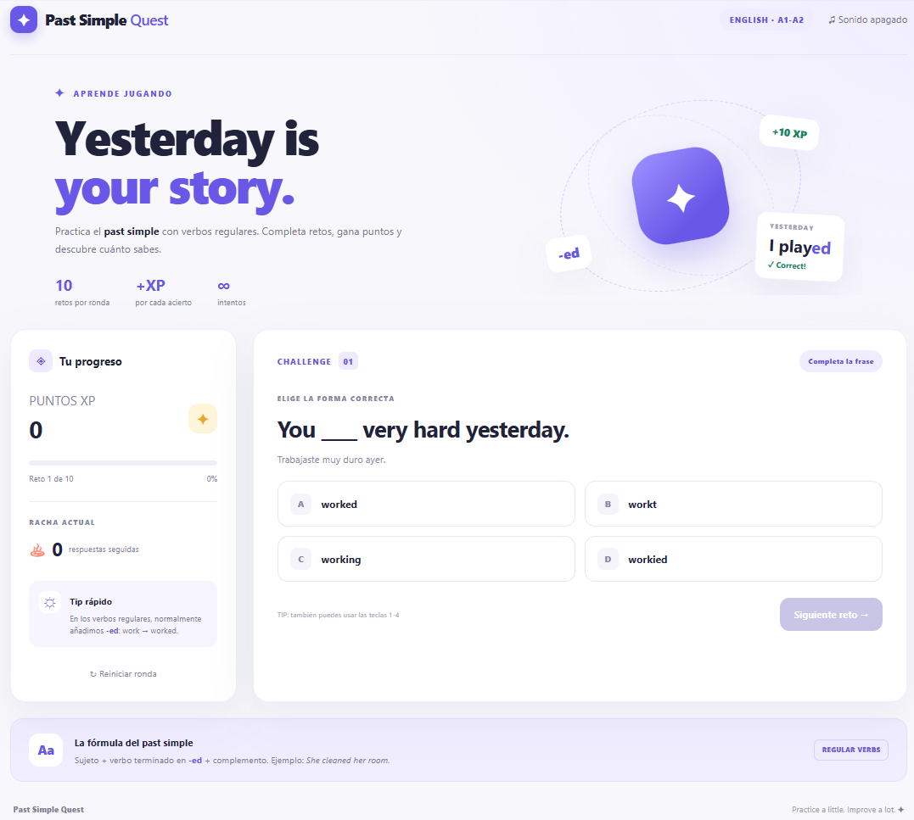

# 🚀 Past Simple Quest — Regular Verbs

Juego educativo interactivo para practicar el **past simple de los verbos regulares en inglés** (nivel A1–A2). Hecho con HTML, CSS y JavaScript puro: sin dependencias, sin instalación y sin conexión a internet.

[](https://github.com/Daniel-dev02/simple-past-test-verb-regular/actions)


🔗 **Demo en vivo:** https://daniel-dev02.github.io/simple-past-test-verb-regular/




## 📋 Tabla de contenidos

- [Características](#-características)
- [Cómo jugar](#-cómo-jugar)
- [Reglas de gramática](#-reglas-de-gramática-incluidas)
- [Instalación y uso local](#-instalación-y-uso-local)
- [Despliegue](#-despliegue)
- [Estructura del proyecto](#-estructura-del-proyecto)
- [Personalización](#-personalización)
- [Accesibilidad y seguridad](#-accesibilidad-y-seguridad)
- [Próximas mejoras](#-próximas-mejoras)
- [Licencia](#-licencia)

## ✨ Características

- 10 retos por ronda, elegidos al azar de un banco de preguntas.
- Frase en inglés con su traducción al español.
- Sistema de **XP** (+10 por acierto) y **racha** de respuestas seguidas.
- Explicación gramatical después de cada respuesta.
- Resumen final con aciertos, XP y precisión.
- Sonido opcional (Web Audio API), apagado por defecto.
- Diseño responsive: móvil, tableta y escritorio.
- Atajos de teclado: `1`–`4` para responder y `Enter` para avanzar.

## 🎮 Cómo jugar

1. Lee la frase en inglés y su traducción.
2. Elige una de las cuatro opciones.
3. Lee la explicación que aparece.
4. Pulsa **Siguiente reto** para continuar.
5. Al terminar, revisa tus resultados y juega otra ronda.

| Acción | Efecto |
|---|---|
| Respuesta correcta | +10 XP y +1 de racha |
| Respuesta incorrecta | 0 XP y la racha vuelve a 0 |

## 📚 Reglas de gramática incluidas

| Regla | Ejemplo |
|---|---|
| Regla general: se añade `-ed` | work → worked |
| Termina en `e`: se añade `-d` | use → used |
| Consonante + `y`: cambia a `-ied` | study → studied |
| Vocal + `y`: se añade `-ed` | play → played |

## 💻 Instalación y uso local

```bash
git clone https://github.com/Daniel-dev02/simple-past-test-verb-regular.git
cd simple-past-test-verb-regular/past_simple_quest
```

Opción 1: abre `index.html` directamente en tu navegador.

Opción 2: usa un servidor local (opcional):

```bash
python -m http.server 8000
# Abre http://localhost:8000
```

## 🌐 Despliegue

El proyecto se publica automáticamente en **GitHub Pages** mediante GitHub Actions cada vez que se hace `push` a `main` (ver `.github/workflows/deploy.yml`). Solo se publica la carpeta `past_simple_quest/`.

Para desplegarlo en tu propia cuenta:

1. Haz un fork del repositorio.
2. Ve a **Settings → Pages** y selecciona **GitHub Actions** como fuente.
3. Haz un push a `main` y espera a que termine el workflow.

También funciona en Netlify, Vercel o Cloudflare Pages usando `past_simple_quest` como directorio de publicación, sin comando de build.

## 🗂️ Estructura del proyecto

```
simple-past-test-verb-regular/
├── .github/workflows/deploy.yml   # Despliegue automático
├── past_simple_quest/
│   ├── index.html                 # Estructura de la interfaz
│   ├── styles.css                 # Estilos y diseño responsive
│   ├── script.js                  # Preguntas, puntuación y lógica
│   └── README.md                  # Manual del juego
├── docs/screenshot.png            # Captura para el README
└── README.md                      # Este archivo
```

## 🛠️ Personalización

Edita el arreglo `questions` en `script.js`:

```js
{
  sentence: "Yesterday, I ____ football with my friends.",
  translation: "Ayer, jugué fútbol con mis amigos.",
  verb: "play",
  answer: "played",
  options: ["playd", "played", "plaied", "playing"],
  note: "Añade -ed: play → played."
}
```

- `answer` debe coincidir exactamente con una de las `options`.
- Cada pregunta necesita 4 opciones distintas.
- `QUESTIONS_PER_ROUND` (por defecto 10) no puede superar el total de preguntas.

## ♿ Accesibilidad y seguridad

- Región `aria-live` para anunciar resultados y navegación por teclado con foco visible.
- Respeta `prefers-reduced-motion`.
- Datos insertados con `textContent` y `createElement`, nunca como HTML.
- Sin cookies, sin llamadas de red y sin almacenamiento de datos personales.

## 🔮 Próximas mejoras

- [ ] Verbos irregulares
- [ ] Niveles de dificultad
- [ ] Guardar la mejor puntuación
- [ ] Modo de escritura libre

## 📄 Licencia

Material de práctica educativa. Puedes modificarlo y adaptarlo para uso personal o escolar.
